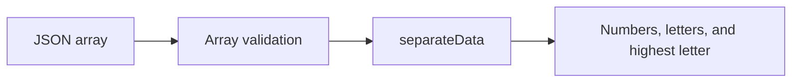

# BFHL REST API

A small Express API exercise that separates numeric values and single-letter alphabetic values from a JSON array and returns the highest alphabetic character.

## What it demonstrates

- JSON request parsing and input validation.
- Separating data into defined response fields.
- A simple REST surface with GET and POST handlers.
- Express middleware and environment-based port selection.

## Run locally

Download and extract the repository. With Node.js and npm installed, run from the root:

```bash
npm install
npm start
```

The server uses port `3000` by default. Set `PORT` to choose another port. `npm run dev` runs the same entry point with nodemon.

## API example

```bash
curl http://localhost:3000/bfhl \
  -H 'Content-Type: application/json' \
  -d '{"data":["a","3","Z","7","b"]}'
```

The response includes `is_success`, configured identity fields, and these data fields:

```json
{
  "numbers": ["3", "7"],
  "alphabets": ["a", "Z", "b"],
  "highest_alphabet": ["Z"]
}
```

`GET /bfhl` returns `{"operation_code":1}`. A POST body whose `data` field is absent or is not an array returns HTTP `400`.

## Request flow



## Source and scope

[Sample.js](sample.js) contains the server, classifier, and handlers. [vercel.json](vercel.json) provides deployment configuration. The identity fields in responses are assignment constants and should be reviewed before adapting the API.

The numeric check uses JavaScript's `isNaN` coercion; it is not strict numeric-string validation. Alphabet matching accepts a single ASCII letter and compares letters case-insensitively. The package's `test` script is a placeholder that exits with an error, not an automated test suite.

Package metadata declares an ISC license; no separate license file is included.
